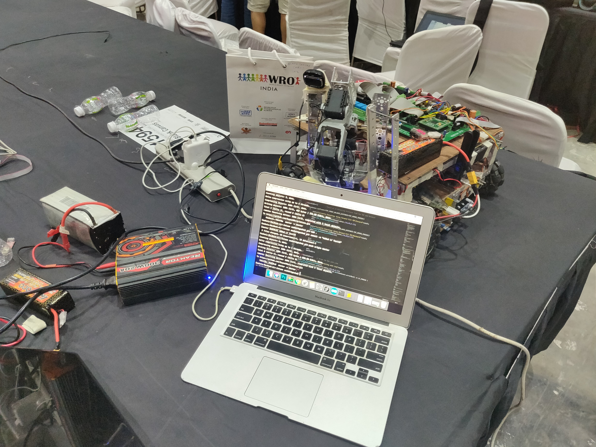

# World Robotics Olympiad — Advanced Robotics Challenge 2018

**Team: SRA-VJTI**

A ROS (Kinetic) package controlling an autonomous robot built for the WRO Advanced Robotics Challenge 2018 "Tetrastack" task — a competition requiring a robot to navigate a course, identify colored blocks by camera, pick them up with a robotic arm, and stack them at designated locations.

[Full problem statement (PDF)](WRO-2018-ARC-Tetrastack-game-rule.pdf)



[](https://youtu.be/DvEpwS4OvB4)

## Hardware Stack

- [NVIDIA Jetson TX2](https://developer.nvidia.com/embedded/jetson-tx2-developer-kit) — onboard compute, runs ROS and the camera/vision node
- [Atmega-128 microcontroller](https://www.microchip.com/wwwproducts/en/ATMEGA128) — low-level motor control, line following, and navigation, connected to the Jetson via `rosserial`
- [DYNAMIXEL AX-12A smart servos](http://www.robotis.us/ax-12a/) — power the robotic arm used to pick up and stack blocks

## Architecture

The package (`Jetson`) is organized around three cooperating ROS nodes plus a set of custom message types:

| Node | Location | Role |
|---|---|---|
| **AtmegaNode** | `scripts/AtmegaNode/` (C++) | Runs on/talks to the Atmega-128 over `rosserial`. Handles line following, navigation, and low-level motor commands (`LineFollowing.cpp`, `Navigation.cpp`, `NavigationMaster.cpp`), plus a library of discrete motion/arm "unit" behaviors (`unit_botForward.cpp`, `unit_arm_pickup.cpp`, `unit_Stack_*.cpp`, etc.) |
| **IpNode (CameraNode)** | `scripts/IpNode/` (Python) | Runs on the Jetson. Captures images and performs block color/position recognition (`block_recognition.py`, `run.py`), publishing results on the `blockColors` topic in response to requests on `camTopic` |
| **ServoNode (DynamixelNode)** | `scripts/ServoNode/` (Python) | Drives the Dynamixel AX-12A servos for the robotic arm — forward/inverse kinematics (`forwardK.py`, `inverseK.py`, `fk3.py`), pickup/stack routines, and torque/angle utilities |

**Custom messages** (`msg/`): `bot.msg` (navigation/reverse flags), `toCam.msg` / `blkData.msg` (camera request/response for block position and color), `Position.msg`, `Vector5.msg`/`Vector5f.msg` (arm kinematic targets), `Dyx2.msg` (arm mode flags: coordinator/pickup/stack).

## Requirements

- Ubuntu with [ROS Kinetic](http://wiki.ros.org/kinetic/Installation/Ubuntu)
- [Dynamixel SDK](http://emanual.robotis.com/docs/en/software/dynamixel/dynamixel_sdk/overview/)
- [OpenCV (Python)](https://docs.opencv.org/3.4/d2/de6/tutorial_py_setup_in_ubuntu.html)
- `rosserial_python` for serial communication with the Atmega-128

## Build & Run

```shell
# Build the package with the catkin build system (ROS Kinetic)
catkin_make

# Run each node in a separate terminal
rosrun Jetson AtmegaNode
rosrun Jetson DynamixelNode.py
rosrun Jetson CameraNode.py
rosrun rosserial_python serial_node.py   # serial link to the Atmega-128 microcontroller
```

`launch/beforeCamera.launch` provides a starting point for launching the pre-camera setup nodes together.

## Repository Layout

| Path | Contents |
|---|---|
| `scripts/AtmegaNode/` | C++ motor control, line following, and arm "unit" behaviors |
| `scripts/IpNode/` | Python camera/vision node for block recognition |
| `scripts/ServoNode/` | Python Dynamixel servo control and arm kinematics |
| `msg/` | Custom ROS message definitions |
| `launch/` | ROS launch files |
| `Images/`, `WRO-2018-ARC-Tetrastack-game-rule.pdf` | Competition photos and official game rules |
